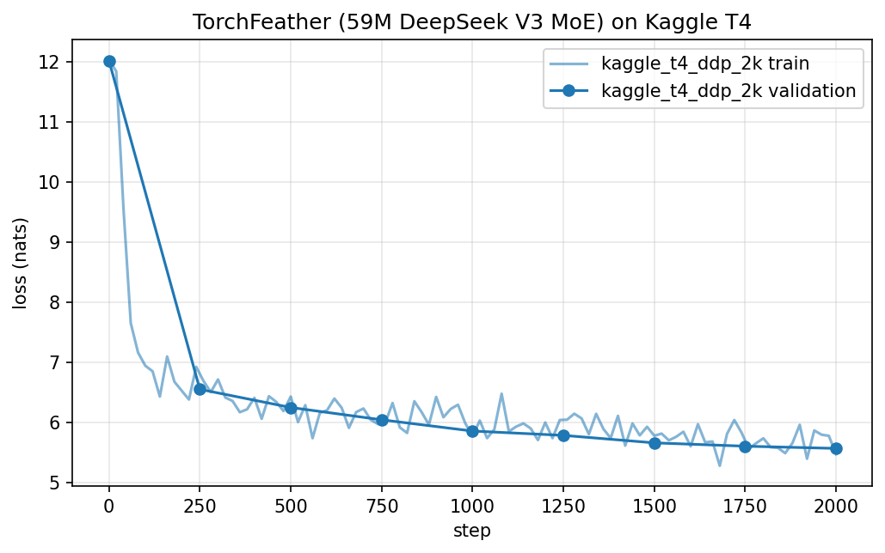

# TorchFeather

TorchFeather is a PyTorch framework for pretraining a DeepSeek V3 style language model across multiple GPUs. The model combines Multi-head Latent Attention (MLA) with Mixture-of-Experts (MoE) feed-forward layers, and the training stack supports data, tensor, pipeline, context and expert parallelism. It streams text from Hugging Face Datasets (FineWeb by default) and covers the infrastructure around training: configuration presets, checkpointing, validation, metrics and profiling.

Maintained by Alok Ashok Kale.

## Results on free GPUs

A 59M-parameter version of the model (same architecture, smaller sizes) trained on Kaggle's free 2× Tesla T4:

- **2,000 steps with DDP** (16.4M tokens): held-out validation loss fell from 12.01 to **5.57** (perplexity 263), with training loss close behind, at 12,300 tokens/s per GPU.
- **DDP, FSDP and tensor parallelism** each trained for 300 steps; DDP and FSDP produced matching loss curves.



Details, logs, metrics and generated samples: [kaggle_t4/README.md](kaggle_t4/README.md).

## Origin and credit

TorchFeather is derived from [torchtitan](https://github.com/pytorch/torchtitan), Meta's PyTorch-native training platform, and is distributed under torchtitan's BSD 3-Clause license (see [LICENSE](LICENSE)). The model, the parallelism strategies (`ParallelDims`, FSDP/DDP setup, tensor/expert/pipeline parallel styles), the MoE layer and its Triton kernels, the checkpoint manager and the optimizer and scheduler containers follow torchtitan's design and code.

What this repository adds or changes:

- **Focused codebase.** Trimmed to one model family (DeepSeek V3 style) and one training path, with modules reorganised and named by what they do.
- **Runs on free GPUs.** `kaggle_t4_*` presets for 1–2 Tesla T4s: a per-expert fallback when `torch._grouped_mm` is unavailable (pre-Ampere GPUs, CPU), a math-kernel fallback for attention, a pure float32 path, and T4 peak-FLOPs for MFU.
- **Evaluation.** Held-out validation loss and perplexity on a fixed set of batches, and top-k text generation that works under DDP, FSDP and tensor parallelism.
- **Metrics without a service.** Every run writes `metrics.jsonl`; Weights & Biases is optional.
- **Reliable shutdown.** The trainer exits as soon as state is saved, instead of hanging on leftover data-loader threads until the watchdog kills it.
- **Cluster tooling.** Nine multi-GPU parallelism presets, a Slurm job template and a submit script.
- **From-scratch examples.** Minimal implementations of a GPipe pipeline schedule, ring attention, tensor-parallel attention and SwiGLU, and block matrix multiplication, each checked against a single-device reference (`parallelism_examples/`).
- **Kaggle notebook and results.** A notebook that trains the small presets end to end and plots the results (`kaggle_t4/`).

## Features

- DeepSeek V3 style transformer with rotary positional embeddings and MLA attention.
- Sparse top-k MoE routing, grouped expert matrix multiplication, and shared experts.
- Data parallel training with DDP, FSDP, or HSDP, alongside tensor, pipeline, context, and expert parallelism.
- Gradient accumulation based on local and global batch sizes.
- Streaming Hugging Face dataset support, token packing, and resumable data-loader state.
- Checkpoint save and restore for model, optimizer, scheduler, trainer, and data-loader state.
- Training metrics, GPU memory reporting, optional PyTorch profiling, and memory snapshots.
- Optional model and loss compilation and activation checkpointing.
- Held-out validation loss and perplexity, and text generation from the trained model.

## Repository layout

```text
torchfeather/
  trainer.py                  Distributed training entry point and training loop
  deepseek_v3/                DeepSeek V3 style transformer, SDPA attention, RoPE, and parallelization
    mixture_of_experts/       MoE layer, token permutation, and Triton permute-index kernels
  parallelism/                Device meshes, DDP/FSDP, expert, pipeline, and activation checkpointing
  training_components/        Data loading, tokenization, optimization, loss, metrics, checkpoints
  job_configs/                Job config dataclasses and built-in DeepSeek V3 parallelism presets
  streaming_datasets/         Hugging Face streaming dataset implementation
  runtime_utils/              Device info, profiling, garbage collection, and peak FLOPs
asset_scripts/
  hf_asset_downloader.py      Download tokenizer or other Hugging Face assets
parallelism_examples/         Small examples for parallelism concepts
kaggle_t4/                    Notebook and guide for training small presets on Kaggle T4 GPUs
prototypes/                   Experimental model argument prototype
submit_slurm_jobs.sh          Submit one or more Slurm jobs
torchrun_trainer.slurm        Slurm job template that starts torchrun
```

## Requirements

- Python 3.10 or newer.
- The dependencies declared in `pyproject.toml`, including PyTorch 2.11.x, `torchdata`, `datasets`, `tokenizers`, `loguru`, and `wandb`.
- For the provided launcher: a Linux cluster with Slurm, NVIDIA GPUs, CUDA-compatible PyTorch, and NCCL. The supplied Slurm template requests 8 GPUs per node.
- Access to the Hugging Face Hub to download the tokenizer and stream the default dataset.

The included Slurm scripts are cluster templates. They are not configured for a local Windows or single-GPU run out of the box.

## Installation and tokenizer setup

From the project directory, install the project and dependencies with [uv](https://docs.astral.sh/uv/):

```bash
uv sync --all-extras
```

Download the tokenizer files expected by the built-in configurations:

```bash
uv run python asset_scripts/hf_asset_downloader.py \
  --repo_id deepseek-ai/deepseek-moe-16b-base \
  --assets tokenizer
```

By default, the script stores assets beneath `assets/hf/`, creating the model directory `assets/hf/deepseek-moe-16b-base`. The built-in model configuration points to this location. To use another location, update `hf_assets_path` in the model configuration. The tokenizer implementation expects `tokenizer.json` and `tokenizer_config.json` in that directory.

The training dataset defaults to the streaming `HuggingFaceFW/fineweb` dataset. Dataset downloads/cache behavior is managed by Hugging Face Datasets. A custom dataset path can be supplied through `Training.dataset_path` in a job configuration, provided it follows the dataset record shape expected by the loader.

## Training

The project reads the configuration name from `TORCHFEATHER_CONFIG`. `torchrun_trainer.slurm` sets it from the Slurm job name and starts `torchrun`; `submit_slurm_jobs.sh` submits that Slurm job. Before launching, edit `torchrun_trainer.slurm` for your cluster, especially:

- `#SBATCH --chdir` and output/error paths
- GPU, CPU, and memory requests
- Slurm partition
- Any cluster-specific environment or rendezvous requirements

Submit a two-node FSDP job with:

```bash
./submit_slurm_jobs.sh multinode fsdp
```

Use one node, or provide a numeric node count, as the first argument:

```bash
./submit_slurm_jobs.sh singlenode fsdp
./submit_slurm_jobs.sh 4 fsdp
```

The supplied `torchrun_trainer.slurm` starts eight processes per node. Adjust its resource requests and `torchrun` arguments together if your cluster uses a different GPU count. The launcher writes job outputs under `outputs/<config-name>/`.

To submit all built-in presets on two nodes, use:

```bash
./submit_slurm_jobs.sh multinode all
```

The `all` option asks for confirmation and then removes the top-level `outputs/` directory before submitting the preset jobs. Review that behavior and back up any output you need before confirming.

### Built-in configurations

Configuration factories are defined in `torchfeather/job_configs/deepseek_v3_presets.py`. All presets are based on the DeepSeek V3 model configuration and most reduce the layer count from the base model definition to six layers for the example training setups.

| Name | Parallelism setup |
| --- | --- |
| `ddp` | Replicated data parallelism |
| `fsdp` | Fully sharded data parallelism |
| `hsdp` | Hybrid sharded data parallelism |
| `pp_tp` | Pipeline and tensor parallelism with sharded data parallelism |
| `fsdp_tp` | FSDP and tensor parallelism |
| `fsdp_cp` | FSDP and context parallelism |
| `hsdp_ep` | HSDP and expert parallelism |
| `fsdp_ep_tp` | FSDP, tensor, and expert parallelism |
| `fsdp_ep_etp` | FSDP, tensor, expert, and expert-tensor parallelism |

The parallelism degrees have to fit the total number of distributed processes and satisfy the constraints documented in `torchfeather/job_configs/job_config_dataclasses.py`. The presets are examples, not universal cluster configurations. Check each preset's world-size assumptions against the number of GPU processes you launch.

To add or change a preset, define a function returning a `JobConfig` and register it in `config_map` in `torchfeather/job_configs/deepseek_v3_presets.py`. Training and model parameters are configured through the dataclasses in `torchfeather/job_configs/job_config_dataclasses.py` and `torchfeather/deepseek_v3/deepseek_v3_model_args.py`.

## Training data and objective

The default data loader streams FineWeb and reads each record's `text` field. It tokenizes text, appends beginning- and end-of-sequence tokens, and packs token streams into fixed-length sequences. Inputs and labels are shifted by one token for causal next-token prediction. Data is split across data-parallel ranks, and iterable dataset state and any partially filled token buffer are included in checkpoints so training can resume.

The training loop calculates cross-entropy loss over valid tokens, supports gradient accumulation, clips gradient norms, updates the optimizer and learning-rate scheduler, and records token and performance metrics. When the data loader is exhausted, the current incomplete accumulation step is canceled and training exits.

## Outputs, checkpoints, and metrics

By default, training writes beneath `./outputs/<config-name>/`. The job configuration controls checkpoint interval, asynchronous checkpointing, retention, resume path, logging frequency, and profiling options. Checkpoints include the state needed to resume training, including optimizer and scheduler state and the data iterator state.

Weights & Biases is included as a dependency for experiment logging. Configure its credentials and run settings in the execution environment as required by your setup. Profiling traces, memory snapshots, metrics, and checkpoints are controlled by the `JobConfig` fields in `torchfeather/job_configs/job_config_dataclasses.py` and the corresponding preset values.

## Running on free Kaggle GPUs

The `kaggle_t4_*` presets train a ~59M-parameter version of the same architecture on 1–2 Tesla T4 GPUs. See [kaggle_t4/README.md](kaggle_t4/README.md).

## Minimal examples

The `parallelism_examples/` directory contains focused examples for pipeline parallelism, tensor-parallel attention and SwiGLU, ring attention, and block matrix multiplication. See [parallelism_examples/README.md](parallelism_examples/README.md) for notes.

The `prototypes/` directory contains a model argument prototype that is not used by the training package. See [prototypes/README.md](prototypes/README.md) for details.

## Development

Development tools are listed in the `dev` dependency group. Install them with:

```bash
uv sync --all-extras --group dev
```

The repository includes Ruff and pre-commit configuration for formatting and linting. There is no automated test suite yet.

