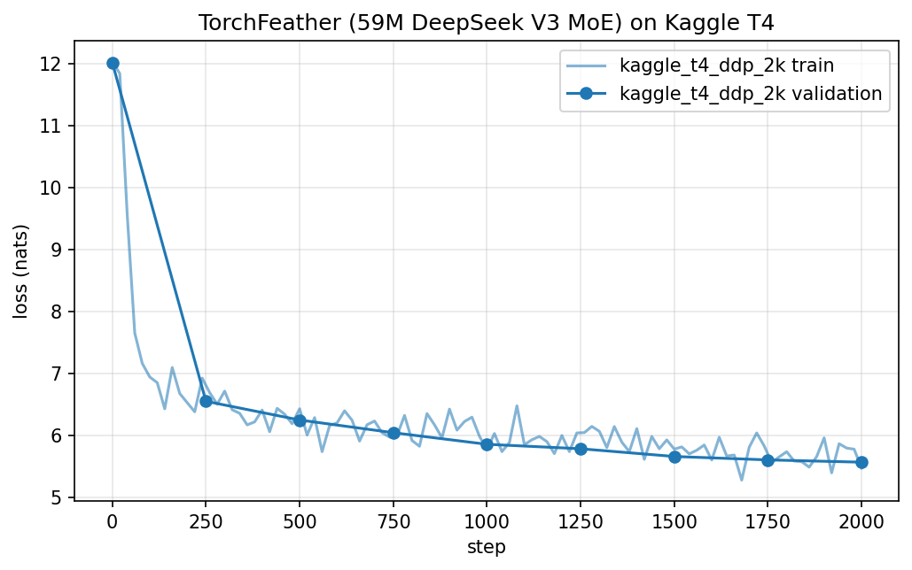
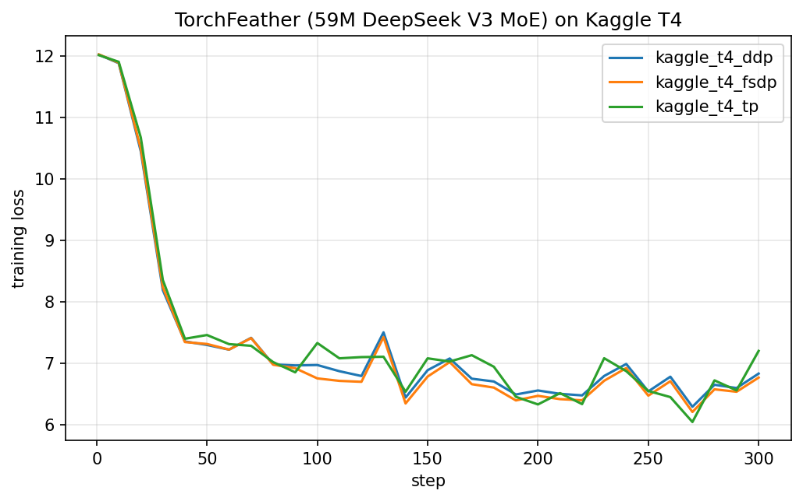

# Running TorchFeather on Kaggle (free T4 GPUs)

The full DeepSeek V3 presets need 8–16 large GPUs. The `kaggle_t4_*` presets in
`torchfeather/job_configs/kaggle_t4_presets.py` keep the same architecture (MLA attention,
MoE with shared experts and load balancing) but shrink it to about 59M parameters so it trains on
Kaggle's free 2× Tesla T4 (15 GiB each).

| Preset | GPUs | What it exercises |
| --- | --- | --- |
| `kaggle_t4_single` | 1 | Single-device training |
| `kaggle_t4_ddp` | 2 | Replicated data parallelism (DDP) |
| `kaggle_t4_fsdp` | 2 | Fully sharded data parallelism (FSDP2) |
| `kaggle_t4_tp` | 2 | 2-way tensor parallelism with loss parallel |
| `kaggle_t4_ddp_2k` | 2 | DDP for 2,000 steps with validation every 250 steps |

All presets evaluate on held-out data (`validation`) and write text samples after the last step (`generation`).

Model: dim 256, 4 layers (1 dense + 3 MoE), 4 heads, 8 routed experts (top-2) + 1 shared expert,
102,400-token vocabulary. Training: float32, batch 8 × 512 tokens per GPU, 300 steps, AdamW with
warmup + cosine decay, streamed FineWeb text.

## Why these settings

- **float32, no `torch.compile`:** T4s (Turing, compute capability 7.5) have no native bfloat16.
- **MoE expert matmul:** `torch._grouped_mm` needs an Ampere-or-newer GPU, so the MoE layer
  automatically uses a per-expert loop on T4s and CPUs (same math, slower). A100/H100 still use
  the grouped kernel.
- **Attention:** falls back to PyTorch's math kernel if the fused kernels reject a shape or dtype.
- **Metrics:** always written to `outputs/<config>/metrics/<time>/metrics.jsonl`; W&B is off in
  these presets.

## Steps

1. Zip the repository (without `outputs/` and `assets/`) and upload it to Kaggle as a private
   dataset named `torchfeather-code`.
2. Create a notebook, then upload `kaggle_t4/torchfeather_kaggle_t4.ipynb`
   (File → Import Notebook), or copy its cells.
3. In the notebook sidebar: **Accelerator → GPU T4 x2**, **Internet → On** (requires a
   phone-verified Kaggle account), and **Add Input → your `torchfeather-code` dataset**.
4. Run all cells. The notebook installs missing packages, downloads the tokenizer
   (`deepseek-ai/deepseek-moe-16b-base`, tokenizer files only), trains each preset with
   `torchrun`, then saves `loss_curve.png` and a results table.

To run one preset by hand from the repository root:

```bash
python asset_scripts/hf_asset_downloader.py --repo_id deepseek-ai/deepseek-moe-16b-base --assets tokenizer
TORCHFEATHER_CONFIG=kaggle_t4_ddp torchrun --standalone --nproc_per_node=2 -m torchfeather.trainer
```

## What this does and does not show

It shows the full training pipeline working end to end on real GPUs: the real model, data
streaming, DDP / FSDP / tensor parallelism, checkpointing and metrics. It does not show
large-scale performance, and a 59M-parameter model trained for 300 steps is not a useful
language model.

## Results (Kaggle, 2× Tesla T4, 21 November 2026)

### 2,000-step run with validation (`kaggle_t4_ddp_2k`)

DDP on two GPUs, 16.4M training tokens, validation on 65,536 held-out tokens from FineWeb's
`sample-10BT` subset every 250 steps. Files: [results_ddp_2000_steps/](results_ddp_2000_steps/).

| Step | 0 | 250 | 500 | 1000 | 1500 | 2000 |
| --- | --- | --- | --- | --- | --- | --- |
| Validation loss | 12.01 | 6.55 | 6.25 | 5.86 | 5.66 | 5.57 |
| Validation perplexity | 165,016 | 701 | 519 | 351 | 288 | 263 |

Throughput 12,300 tokens/s per GPU (0.33 s per step, 27% of the T4's fp32 peak), peak memory
6.9 GiB. Training loss over the last 100 steps averaged 5.66, close to the validation loss, so the
model is not overfitting at this scale. Generated samples are in
[samples.txt](results_ddp_2000_steps/samples.txt): locally grammatical English without coherent
meaning, which is what a 59M-parameter model shows after 16M tokens.



### Parallelism comparison, 300 steps each

Files: [results_strategy_comparison_300_steps/](results_strategy_comparison_300_steps/).

| Preset | Training loss (step 1 → 300) | Tokens/s per GPU | Peak memory |
| --- | --- | --- | --- |
| `kaggle_t4_ddp` | 12.02 → 6.83 | 12,002 | 7.2 GiB |
| `kaggle_t4_fsdp` | 12.03 → 6.76 | 10,565 | 7.3 GiB |
| `kaggle_t4_tp` | 12.02 → 7.20 | 7,349 | 4.3 GiB |

DDP and FSDP produce nearly identical loss curves (same data and seed, different sharding), a
useful correctness check. The TP preset has no data parallelism, so it sees half the tokens per step.


